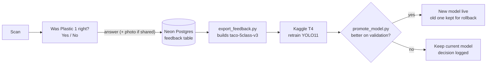

# Adaptive learning

EcoRevive improves from the way it is used. Users tell the app when a detection was right or wrong; with their consent the photo becomes training data; the detector is retrained on it; and the new model goes live **only if it scores better** on the same validation photos.



## 1. Collect feedback (automatic)

- After a scan, the website and the Android app ask **"Was Plastic 1 (plastic cup) right?"** with **Yes** / **No, it's wrong**.
- `POST /v1/feedback` stores: time, model version, class, confidence, the box, the item name, and whether it was right.
- **Photos only with consent.** On the website the user can tick *"Share this photo to help train the model"*. The photo is re-encoded on the server, so location and camera metadata are dropped. The Android app never sends photos with feedback.
- The browser's anonymous id is stored only as a hash. **Clear history** deletes that browser's scans, feedback and shared photos. Each browser keeps at most 500 feedback rows.
- `GET /v1/learning` shows the totals; the website's History page shows them as **Model learning**.

## 2. Build the next training set

When at least 50 photos have been shared (the History page says how many):

```powershell
$env:DATABASE_URL = "<Neon connection string: Vercel project → Storage → Neon → .env.local>"
backend/.venv/Scripts/python ml/scripts/export_feedback.py `
    --base ml/data/processed/taco-5class-v2 --out ml/data/processed/taco-5class-v3
```

Per shared photo:

| Feedback | Becomes |
|---|---|
| Box marked **right** | a Plastic label |
| Box marked **wrong** | no label, so the model learns that spot is not plastic |
| Every box on the photo wrong | a "no plastic" photo (empty label file) |

Feedback photos are added to **train only**. Validation and the locked test split are never changed, so the old and new models are compared fairly.

## 3. Retrain (Kaggle, free GPU)

1. Package the new dataset: `backend/.venv/Scripts/python ml/scripts/package_for_colab.py --dataset ml/data/processed/taco-5class-v3 --out ml/artifacts/ecorevive-bundle-v3.zip`, and upload the zip as a Kaggle dataset.
2. In `ml/kaggle/train_kernel.py`, update `BUNDLE_SHA256` to the new zip's checksum and `MODEL_VERSION` (for example `0.3.0-preview`).
3. Push and run the kernel (same steps as the v2 training in docs/EVALUATION.md). It exports ONNX and TFLite with parity checks.

## 4. Promote only a better model

```powershell
backend/.venv/Scripts/python ml/scripts/promote_model.py --candidate <downloaded artifacts folder>
```

- Both models are evaluated on the **same validation photos** with `evaluate_onnx.py`.
- The candidate is promoted only if photo-level **balanced accuracy rises by at least 0.01** and **Plastic AP@0.50 does not fall by more than 0.02**.
- On promotion the current model is kept in `backend/models/previous` for rollback. Every decision, promoted or not, is appended to `ml/reports/promotion_ledger.jsonl`.
- Then redeploy with `deploy/deploy_vercel.py`. For the phone, copy the new `model.tflite` and `manifest.json` into `mobile/assets/model/` and rebuild the APK.

**Example decision (2026-11-23, dry run):** the gate compared the older `0.1.0-preview` against the live `0.2.0-preview-small` and refused it: balanced accuracy 0.549 vs 0.644 (−0.095). The entry is in the ledger.

## What is automatic and what is not

| Step | Automatic? |
|---|---|
| Collecting answers and consented photos | Yes, every scan |
| Building the training set | One command |
| Retraining | One Kaggle run, started by a team member (free GPU, about 35 minutes) |
| Deciding whether the new model is better | Yes, `promote_model.py` decides and logs it |
| Going live | One deploy command |

Retraining is started by hand on purpose: the training set should be looked at before it is used, and the free GPU quota is limited.
