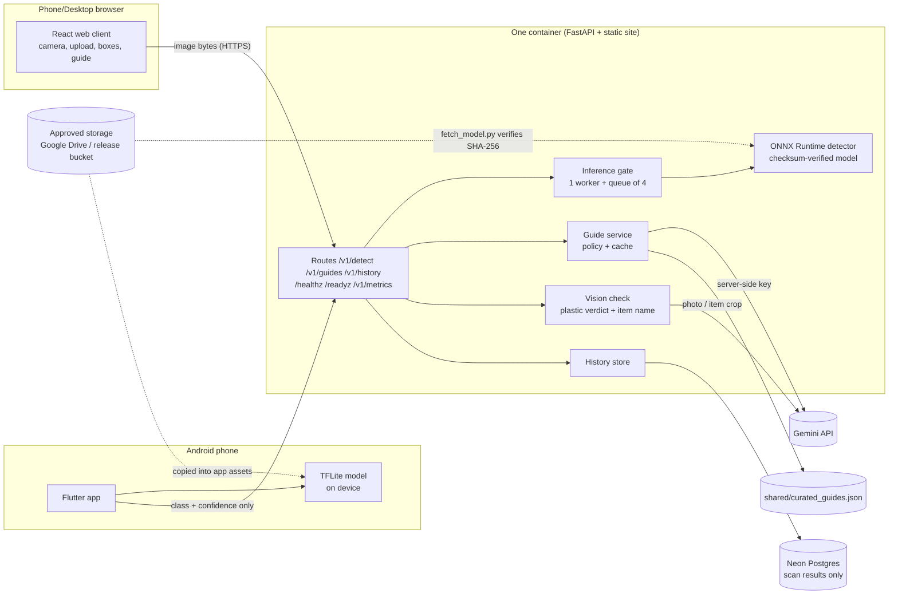

# Architecture

## Request flow (web)

1. The browser captures a frame (max 1280 px, JPEG) or re-encodes an upload in the browser. Re-encoding applies EXIF rotation and drops metadata such as GPS.
2. `POST /v1/detect` sends the raw bytes with an `Idempotency-Key`. The server checks size, decodes the image to verify it, limits the pixel count, and rebuilds the image from its pixels only. It is never written to disk.
3. The inference gate runs letterbox → ONNX → decode + NMS → box mapping on a worker thread, off the event loop. When the worker and queue are full, the server answers `503 overloaded` with `Retry-After` at once.
4. The response lists boxes normalised to the uploaded image, plus a quality verdict: `ok`, `no_detections`, `low_confidence` or `ambiguous`.
   - **Captures and uploads** (never live preview frames) send `?verify=true&save=true`.
   - `verify`: Gemini vision looks at the whole photo and answers "does it contain plastic?" with the item names it sees. Its answer is the final `verdict` (the rule chosen on validation, see EVALUATION.md). If Gemini is unavailable, the detector's boxes decide, as before.
   - `save`: the result (time, model version, class and confidence of each item) is stored in the history database for this browser. Photos and boxes are never stored.
5. When the user picks an item, `POST /v1/guides` returns a guide.
   - Hazardous → always the curated disposal guide.
   - Uncertain scan → `409 confirmation_required` until the user confirms the material.
   - Otherwise Gemini, with a timeout and one retry for temporary errors. Unsafe or malformed output falls back to the curated guide, and the guide shows which source it came from.
   - The website sends a small crop of the selected item. Gemini names the item first (for example "glasses frame"), and the guide is written for that item. An item that is clearly not plastic gets `422 not_this_material`. A name such as "vape" still gets the curated disposal guide.
   - Glass and Metal guides always include the curated sharp-edge precautions.

Live preview samples about one frame per second at 640 px. It keeps at most one request in flight, doubles its interval on busy or slow responses, and stops the camera tracks when the user leaves the screen or hides the tab.

## Android

The app runs decode, EXIF rotation, letterbox, TFLite and decoding in a background isolate, using the same geometry as the backend. Detection works offline. Guides come from the same API when `API_BASE` is set at build time. Otherwise, or when the server can't be reached, the app shows the bundled curated guides, labelled as offline.

## Single source of truth

- Classes: `shared/classes.json`. Checked by the ML tests, the backend at model load, the ONNX metadata, and a Flutter test that compares the bundled copy.
- Curated guides: `shared/curated_guides.json`. Read by the backend and bundled in the app.
- API contract: `backend/app/schemas.py` (OpenAPI at `/docs`), mirrored by `web/src/types.ts` and `mobile/lib/guides.dart`.

## Decisions and trade-offs

| Decision | Why | Trade-off |
|---|---|---|
| One container serves the site and the API | Same origin, so no CORS, one deploy and one rollback | Scaling the site means scaling the API |
| ONNX Runtime on CPU in the API | Small image, no PyTorch, matches the exported artifact | Slower than a GPU; capacity is limited on purpose |
| One worker, bounded queue, explicit 503 | Predictable latency and memory; clients back off | Peak throughput is capped until measured on the host |
| In-memory idempotency, rate limit and guide cache | Single instance, so no Redis needed | Must move to a shared store before running more than one replica |
| Neon Postgres for scan history only (pg8000, SQLite locally) | Free on Vercel; history and totals survive restarts | History is per browser (anonymous id, stored hashed), not per person |
| Gemini vision decides the plastic verdict | Measured best on validation (balanced accuracy 77% vs 64% for the detector alone) | Each capture makes a Gemini call; when Gemini is down the detector decides |
| TFLite on the phone | Required by the action plan; works offline | A model update needs an app rebuild |
